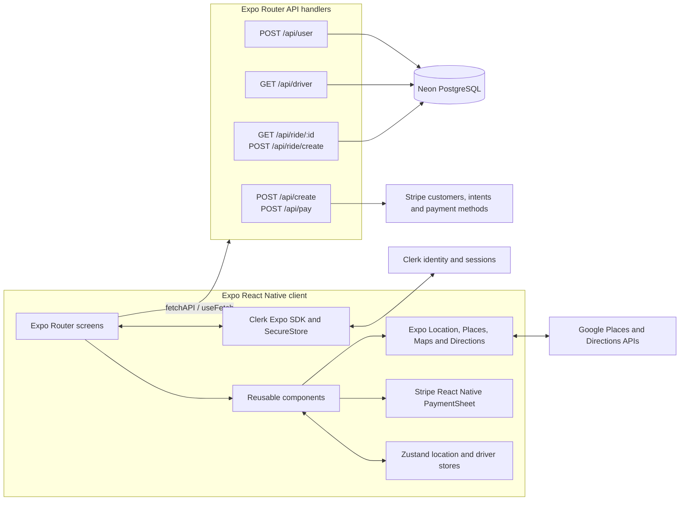

# Architecture

## Scope

This repository is a React Native/Expo ride-booking demo (branded “Ryde” in onboarding) for iOS, Android, and Expo web. Expo Router supplies both client screens and server API routes. The documented behavior below reflects the checked-in implementation; it is not a production dispatch platform. In particular, nearby drivers are synthetic map markers, fare/time are client estimates, and chat is a placeholder.

## System overview



**Client:** `app/` contains file-based screens and server handlers; `components/` contains shared UI; `lib/` contains fetch, auth and map helpers; `store/` holds in-memory Zustand state; `constants/` and `assets/` hold labels and visuals; `types/` defines shared data shapes. Styling uses NativeWind/Tailwind. The root layout loads Jakarta fonts, keeps the native splash visible until fonts load, then mounts Clerk.

**Backend/data:** API handlers run in the Expo Router server runtime. Neon’s serverless SQL client accesses `users`, `drivers`, and `rides`; no schema/migration files are present in this repository. Stripe server SDK calls use `STRIPE_SECRET_KEY`. There is no separate dispatch service or driver app in this codebase.

## Routes and component structure

| Route | Responsibility |
|---|---|
| `/` | Redirect to welcome when signed out, home when signed in |
| `/(auth)/welcome` | Three onboarding slides; continue/skip to sign-up |
| `/(auth)/sign-in` | Clerk email/password sign-in and Google OAuth component |
| `/(auth)/sign-up` | Clerk account creation, email-code verification, create local user row |
| `/(root)/(tabs)/home` | Request foreground location, show map/search and up to five recent rides; sign out |
| `/(root)/find-ride` | Set pickup and destination via Places autocomplete |
| `/(root)/confirm-ride` | Select an estimated driver from cards |
| `/(root)/book-ride` | Show selected driver, estimate, route addresses and PaymentSheet |
| `/(root)/(tabs)/rides` | Ride history |
| `/(root)/(tabs)/profile` | Read-only Clerk profile fields |
| `/(root)/(tabs)/chat` | Static empty-state screen; no messaging backend |
| `/(api)/user` | `POST` local user record |
| `/(api)/driver` | `GET` driver rows |
| `/(api)/ride/[id]` | `GET` ride history for the supplied user ID |
| `/(api)/ride/create` | `POST` ride row |
| `/(api)/(stripe)/create` | `POST` Stripe customer lookup/create, ephemeral key and PaymentIntent |
| `/(api)/(stripe)/pay` | `POST` attach payment method and confirm PaymentIntent |

The shared `RideLayout` places `Map` behind a bottom sheet. `GoogleTextInput`, `DriverCard`, `RideCard`, `Payment`, `CustomButton`, and `InputField` compose the booking and account flows. Tabs are Home, Rides, Chat and Profile.

## Booking and payment flow

```mermaid
sequenceDiagram
  actor Rider
  participant App as Expo screens and stores
  participant Google as Places/Directions
  participant API as Expo API routes
  participant DB as Neon
  participant Stripe as Stripe
  Rider->>App: Open app / sign in or sign up
  App->>Google: Request foreground GPS; reverse geocode
  App->>API: GET /api/driver and GET /api/ride/:userId
  API->>DB: Read drivers and user's rides
  Rider->>App: Search destination and choose route
  App->>Google: Places details and Directions requests
  App->>App: Generate nearby marker offsets; estimate total minutes and fare
  Rider->>App: Select driver, confirm ride
  App->>API: POST /api/create (customer, amount)
  API->>Stripe: Create/find customer, ephemeral key, PaymentIntent
  Stripe-->>App: PaymentSheet confirmation flow
  App->>API: POST /api/pay (payment method, intent, customer)
  API->>Stripe: Attach payment method and confirm intent
  Stripe-->>API: Intent result
  App->>API: POST /api/ride/create (route, estimate, user, driver, status)
  API->>DB: Insert ride
  App-->>Rider: Booking success modal
```

**Estimate semantics:** `lib/map.ts` generates driver positions by random offsets around the rider, then calls Google Directions for driver-to-pickup and pickup-to-destination durations. It adds those durations and applies `$0.50/minute`; it does not calculate route distance or use a distance-based tariff. The map draws the selected origin-destination directions. The client sends the selected estimate to payment and ride creation; there is no server-side fare recomputation or price guarantee. Values are currently USD; the PaymentIntent amount is formed from whole-dollar `parseInt(amount) * 100`, so cents in a displayed estimate are discarded. Ride creation stores `parseInt(amount) * 100` as `fare_price`.

## API and persistence details

All API paths above are Expo Router file routes (the `(api)` and `(stripe)` groups are omitted from URL paths, while the client helper currently calls them with grouped paths). Responses generally use `{ data }` and errors use `{ error }`.

| Method/path | Input or behavior | Data effect |
|---|---|---|
| `POST /api/user` | `{ name, email, clerkId }`; required-field check | Inserts `users(name,email,clerk_id)` |
| `GET /api/driver` | None | Returns all `drivers` |
| `GET /api/ride/:id` | User ID path parameter | Joins rides to drivers; newest first |
| `POST /api/ride/create` | Route addresses/coordinates, time, fare, payment status, driver and user IDs | Inserts and returns ride |
| `POST /api/create` | `{ name, email, amount }` | Finds/creates Stripe customer, creates ephemeral key and USD PaymentIntent |
| `POST /api/pay` | `{ payment_method_id, payment_intent_id, customer_id }` | Attaches method and confirms intent |

Client fetch helpers are `fetchAPI` and `useFetch` in `lib/fetch.ts`. The client does not currently attach Clerk session tokens to API requests. Server handlers do not verify Clerk identity/authorization; user and driver IDs in requests are therefore not trusted identities. The payment handler accepts client-supplied intent/customer IDs and has no webhook reconciliation. Treat API and booking persistence as demo-grade.

## Authentication, configuration and security

Clerk owns credentials, email verification, Google OAuth and sessions. `lib/auth.ts` persists Clerk tokens through Expo SecureStore. The root route checks Clerk’s signed-in state for its initial redirect. Sign-up creates a Clerk account, verifies an email code, then calls the local user endpoint; OAuth creates a local row for newly created Clerk users. Profile data is read from Clerk.

Environment configuration expected by the code/README:

- `EXPO_PUBLIC_CLERK_PUBLISHABLE_KEY`
- `EXPO_PUBLIC_PLACES_API_KEY`, `EXPO_PUBLIC_DIRECTIONS_API_KEY`
- `DATABASE_URL`
- `STRIPE_SECRET_KEY`, `EXPO_PUBLIC_STRIPE_PUBLISHABLE_KEY`
- `EXPO_PUBLIC_SERVER_URL` is described in README setup; fetch helpers currently use relative paths, and no code here consumes this variable.

Public-prefixed keys are bundled into the client and must be restricted by provider (app/package, API, and usage limits). Keep database and Stripe secret keys server-side. SQL uses Neon parameter interpolation, but authorization, ownership checks, rate limits, idempotency, validation of amounts/coordinates, and payment webhooks are absent. The create-user endpoint has no uniqueness/upsert handling visible here. Location requires foreground permission; denial currently leaves the app without a usable location flow. Do not describe the map’s randomized driver positions or client fare estimate as live/authoritative dispatch or exact pricing.

## Main code references

- Route trees: `app/_layout.tsx`, `app/(auth)/`, `app/(root)/`, `app/(api)/`
- Booking/map: `components/Map.tsx`, `components/RideLayout.tsx`, `components/Payment.tsx`, `lib/map.ts`
- State/auth/network: `store/index.ts`, `lib/auth.ts`, `lib/fetch.ts`
- Shared models: `types/type.d.ts`
- Project setup and dependencies: `README.md`, `package.json`
